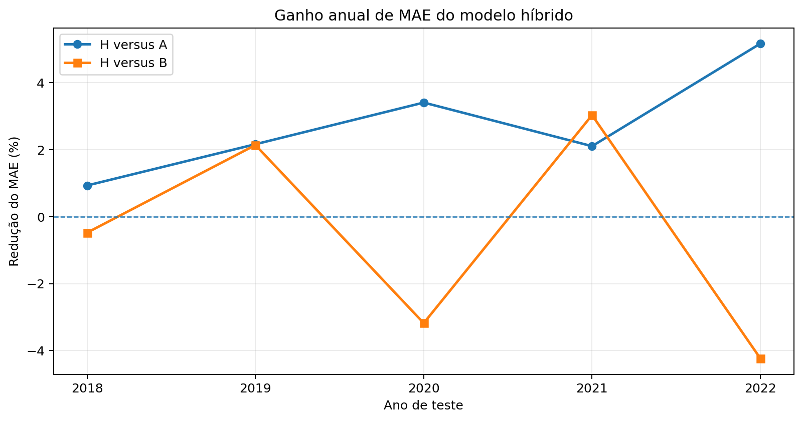
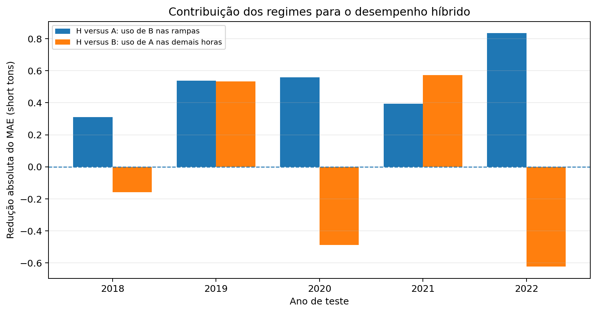
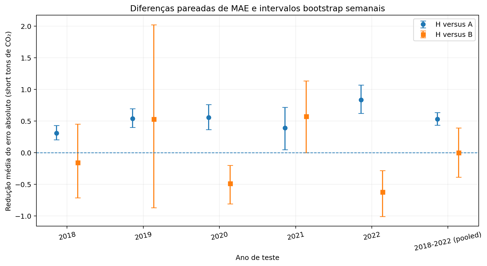

# Notebook 03A.06: Modelo híbrido sensível ao regime operacional

## 1. Objetivo e delimitação

Avaliar se a seleção condicional entre dois modelos XGBoost melhora a estimativa horária de emissões de CO₂ da **Iatan Unit 2**, em relação ao uso isolado de cada modelo.

O experimento se limita à unidade, aos atributos operacionais e aos anos efetivamente analisados.

A hipótese foi motivada pelos resultados do Notebook 03A.05: a trajetória operacional mostrou benefício localizado em rampas intensas, sem benefício global consistente na avaliação de 2025.

O presente notebook testa uma regra específica, sem pressupor que a hipótese já tenha sido confirmada.

## 2. Base de dados e cenários

- Variável-alvo: `CO2 Mass (short tons)`, massa de CO₂ por registro horário.
- **Cenário A:** XGBoost com 1 variável explicativa, correspondente à carga elétrica da própria hora.
- **Cenário B:** XGBoost com 7 variáveis explicativas, incluindo carga atual, informações defasadas e trajetória operacional.
- **Cenário H:** seleção determinística entre as previsões dos modelos A e B.
- Período de avaliação retrospectiva: **2018 a 2022**.
- Backtests executados: **5**.
- Total de observações horárias comuns: **32,533**.
- Horas classificadas como rampas intensas: **6,473**, correspondentes a **19.90%** do conjunto agregado.

A comparação utiliza as mesmas observações elegíveis para os três cenários, evitando diferenças de desempenho decorrentes da utilização de conjuntos de teste incompatíveis.

## 3. Fundamentação metodológica

### 3.1. Gradient-Boosted Regression Trees (XGBoost)

Foi utilizada regressão supervisionada baseada em *gradient boosting*, técnica que combina árvores de decisão ajustadas sequencialmente para melhorar a função preditiva.

Os modelos A e B pertencem à mesma família algorítmica e diferem no conjunto de variáveis explicativas.

O Cenário A representa a hipótese de que a carga elétrica instantânea contém informação suficiente para produzir estimativas competitivas das emissões.

O Cenário B incorpora informações da trajetória operacional para avaliar se a representação temporal acrescenta valor preditivo.

### 3.2. Rolling-origin evaluation (backtesting temporal)

Foram avaliados separadamente os anos-alvo **2018, 2019, 2020, 2021, 2022**.

Em cada backtest, somente períodos anteriores ao ano-alvo participaram do treinamento e da seleção da complexidade.

Esse procedimento corresponde a uma avaliação retrospectiva com origem temporal progressiva, distinguindo-se de uma divisão aleatória dos registros.

### 3.3. Early stopping e final refit

A seleção do número de árvores empregou os últimos **20% das observações elegíveis do ano anterior** ao teste como conjunto de validação cronológica.

O mecanismo de *early stopping* permitiu identificar a complexidade de cada modelo a partir da evolução do erro de validação.

Após a seleção, os modelos foram ajustados novamente com todo o passado elegível, procedimento denominado *final refit*.

O número de árvores foi selecionado separadamente para os modelos A e B.

| Ano-alvo | Modelo | Treino seleção (n) | Validação (n) | Árvores selecionadas | RMSE validação |
| --- | --- | --- | --- | --- | --- |
| 2018 | A | 49347 | 1701 | 302 | 33.3128 |
| 2018 | B | 49347 | 1701 | 203 | 32.8208 |
| 2019 | A | 55277 | 1058 | 106 | 54.7474 |
| 2019 | B | 55277 | 1058 | 670 | 52.7329 |
| 2020 | A | 62495 | 1540 | 94 | 26.6134 |
| 2020 | B | 62495 | 1540 | 115 | 26.1595 |
| 2021 | A | 69287 | 1314 | 174 | 17.4922 |
| 2021 | B | 69287 | 1314 | 437 | 15.5242 |
| 2022 | A | 75963 | 1341 | 438 | 22.2842 |
| 2022 | B | 75963 | 1341 | 225 | 18.0930 |

### 3.4. Deterministic hard gating

A arquitetura híbrida utiliza uma regra determinística de seleção de especialistas:

```text
Se |ΔP(t)| >= P90 de |ΔP| no treinamento:

    Previsão H(t) = Previsão B(t)

Caso contrário:

    Previsão H(t) = Previsão A(t)
```

O limiar correspondente ao percentil **90%** foi estimado exclusivamente a partir dos dados de treinamento de cada backtest.

A arquitetura é inspirada no conceito de *Mixture of Experts*, mas não utiliza uma rede de gating aprendida nem combina as previsões por médias ponderadas.

Nenhum limiar foi calibrado utilizando as emissões observadas nos anos de teste.

### 3.5. Paired loss differential

A comparação pareada utiliza os erros dos três modelos nas mesmas observações.

Definindo o erro absoluto como:

`AE(t) = |y(t) - y_pred(t)|`

As diferenças de perdas são:

`d_HA(t) = AE_A(t) - AE_H(t)`

`d_HB(t) = AE_B(t) - AE_H(t)`

Valores positivos representam redução do erro absoluto pelo modelo híbrido.

Essa formulação permite determinar a contribuição efetiva das decisões tomadas pelo gate.

### 3.6. Regime-conditional error decomposition

Os resultados foram separados em:

- rampas intensas;
- demais horas de operação.

Como H utiliza B nas rampas e A nas demais horas, é possível decompor exatamente as diferenças de MAE em função de cada regime operacional.

### 3.7. Temporal stability analysis

Foi realizada uma análise descritiva dos ganhos por ano e mês.

Essa estratificação permite observar se os benefícios estão distribuídos temporalmente ou concentrados em determinados períodos.

Os meses não representam necessariamente observações estatisticamente independentes.

### 3.8. Weekly block bootstrap

Foram realizadas **2,000 reamostragens** de blocos semanais completos, com reposição dentro de cada ano.

Foram calculados intervalos percentílicos exploratórios de 95% para as reduções médias dos erros absolutos.

A agregação global manteve os pesos originais dos anos.

O procedimento preserva a dependência das observações dentro de cada semana, mas não elimina toda a dependência temporal.

## 4. Resultados anuais

Os valores de MAE e RMSE são apresentados em short tons de CO₂ por observação horária.

Ganhos positivos representam redução do erro pelo modelo híbrido.

| Ano | n | P90 (MW/h) | Rampas (%) | MAE A | MAE B | MAE H | Ganho H/A (%) | Ganho H/B (%) | RMSE A | RMSE B | RMSE H | R² A | R² B | R² H | Bias A | Bias B | Bias H |
| --- | --- | --- | --- | --- | --- | --- | --- | --- | --- | --- | --- | --- | --- | --- | --- | --- | --- |
| 2018 | 5287 | 37.0000 | 9.4950 | 33.3465 | 32.8785 | 33.0359 | 0.9315 | -0.4786 | 38.7665 | 38.2643 | 38.4448 | 0.9219 | 0.9239 | 0.9232 | -32.5746 | -32.3273 | -32.3605 |
| 2019 | 7700 | 37.0000 | 13.7403 | 24.9037 | 24.8975 | 24.3647 | 2.1643 | 2.1399 | 28.9482 | 29.8397 | 28.5003 | 0.9241 | 0.9193 | 0.9264 | -23.9456 | -23.2848 | -23.2530 |
| 2020 | 6566 | 39.0000 | 24.5659 | 16.3688 | 15.3233 | 15.8108 | 3.4093 | -3.1809 | 21.2132 | 19.2979 | 20.1698 | 0.9783 | 0.9820 | 0.9803 | -12.9377 | -10.8607 | -11.5579 |
| 2021 | 6703 | 43.0000 | 25.3319 | 18.6811 | 18.8600 | 18.2876 | 2.1064 | 3.0347 | 24.6190 | 24.0776 | 23.4251 | 0.9831 | 0.9838 | 0.9847 | -0.3191 | -0.4936 | 0.3833 |
| 2022 | 6277 | 49.0000 | 25.5217 | 16.1484 | 14.6909 | 15.3133 | 5.1717 | -4.2368 | 29.1023 | 27.2351 | 27.8268 | 0.9762 | 0.9791 | 0.9782 | -3.1262 | -2.0121 | -2.6863 |

O modelo H apresentou menor MAE que A em **5/5 anos**.

O modelo H apresentou menor MAE que B em **2/5 anos**.

O modelo H superou simultaneamente A e B em **2/5 anos**.

O *bias* corresponde à média de `observado - previsto`. Valores negativos indicam superestimação média, enquanto valores positivos indicam subestimação média.

## 5. Síntese global

| Indicador | A | B | H |
| --- | ---: | ---: | ---: |
| MAE agregado (pooled) | 21.5819 | 21.0489 | 21.0490 |
| RMSE agregado (pooled) | 28.6650 | 28.0430 | 27.8749 |
| Média dos MAEs anuais | 21.8897 | 21.3300 | 21.3625 |

O modelo H apresentou ganho agregado de MAE de **+2.4692%** em relação ao modelo A.

Em relação ao modelo B, o ganho agregado foi de **-0.0001%**.

O desempenho agregado do modelo H foi **praticamente idêntico ao B no MAE agregado**.

A avaliação *pooled* pondera cada ano pela quantidade de observações elegíveis.

A média dos MAEs anuais atribui o mesmo peso a todos os anos.

Essas duas medidas oferecem leituras complementares da estabilidade do desempenho.

## 6. Diagnóstico por regime operacional

| Ano | Regime | n | MAE A | MAE B | MAE H | Ganho B/A (%) |
| --- | --- | --- | --- | --- | --- | --- |
| 2018 | Rampa intensa | 502 | 31.1285 | 27.8571 | 27.8571 | 10.5096 |
| 2018 | Demais horas | 4785 | 33.5792 | 33.4053 | 33.5792 | 0.5178 |
| 2019 | Rampa intensa | 1058 | 21.9748 | 18.0521 | 18.0521 | 17.8509 |
| 2019 | Demais horas | 6642 | 25.3702 | 25.9879 | 25.3702 | -2.4345 |
| 2020 | Rampa intensa | 1613 | 19.2559 | 16.9842 | 16.9842 | 11.7974 |
| 2020 | Demais horas | 4953 | 15.4286 | 14.7825 | 15.4286 | 4.1881 |
| 2021 | Rampa intensa | 1698 | 21.6649 | 20.1116 | 20.1116 | 7.1699 |
| 2021 | Demais horas | 5005 | 17.6688 | 18.4353 | 17.6688 | -4.3382 |
| 2022 | Rampa intensa | 1602 | 18.4745 | 15.2022 | 15.2022 | 17.7126 |
| 2022 | Demais horas | 4675 | 15.3513 | 14.5156 | 15.3513 | 5.4438 |

A vantagem do Cenário B sobre A durante rampas intensas foi **observada nos cinco anos**.

Entretanto, esse resultado não significa que o Cenário B seja necessariamente inferior nas demais condições operacionais.

A decomposição das diferenças de MAE apresenta as contribuições das decisões do gate:

| Ano | Redução H/A por rampas | Redução H/B por demais horas |
| --- | --- | --- |
| 2018 | 0.3106 | -0.1574 |
| 2019 | 0.5390 | 0.5328 |
| 2020 | 0.5581 | -0.4874 |
| 2021 | 0.3935 | 0.5723 |
| 2022 | 0.8351 | -0.6224 |

A redução do MAE de H em relação a A decorre exclusivamente da utilização de B durante as rampas intensas.

A diferença de H em relação a B decorre exclusivamente da utilização de A nas demais horas.

Contribuições negativas indicam que a decisão do gate deteriorou o desempenho em relação ao modelo de referência correspondente.

## 7. Estabilidade temporal

Foram analisados **57 meses elegíveis**.

- Meses com H melhor que A: **50/57**.
- Meses com H melhor que B: **22/57**.
- Meses com H melhor que ambos: **17/57**.

Esses resultados são descritivos.

Os meses apresentam quantidades diferentes de observações e não constituem necessariamente réplicas estatisticamente independentes.

A frequência de vitórias não substitui a análise da magnitude das diferenças de erro.

## 8. Incerteza das diferenças pareadas

Os intervalos foram calculados com *weekly block bootstrap*.

Valores positivos representam redução do erro absoluto pelo modelo híbrido.

| Período | Comparação | Redução média MAE | IC 2,5% | IC 97,5% | Leitura do intervalo |
| --- | --- | --- | --- | --- | --- |
| 2018 | H_vs_A | 0.3106 | 0.2067 | 0.4324 | positivo em todo o intervalo |
| 2018 | H_vs_B | -0.1574 | -0.7123 | 0.4539 | inclui zero |
| 2019 | H_vs_A | 0.5390 | 0.3996 | 0.6954 | positivo em todo o intervalo |
| 2019 | H_vs_B | 0.5328 | -0.8680 | 2.0212 | inclui zero |
| 2020 | H_vs_A | 0.5581 | 0.3669 | 0.7625 | positivo em todo o intervalo |
| 2020 | H_vs_B | -0.4874 | -0.8098 | -0.2001 | negativo em todo o intervalo |
| 2021 | H_vs_A | 0.3935 | 0.0506 | 0.7160 | positivo em todo o intervalo |
| 2021 | H_vs_B | 0.5723 | 0.0020 | 1.1349 | positivo em todo o intervalo |
| 2022 | H_vs_A | 0.8351 | 0.6232 | 1.0683 | positivo em todo o intervalo |
| 2022 | H_vs_B | -0.6224 | -1.0096 | -0.2804 | negativo em todo o intervalo |
| 2018-2022 (pooled) | H_vs_A | 0.5329 | 0.4359 | 0.6351 | positivo em todo o intervalo |
| 2018-2022 (pooled) | H_vs_B | -0.0000 | -0.3870 | 0.3924 | inclui zero |

### 8.1. Híbrido versus Cenário A

A redução média agregada do MAE foi:

**+0.5329 short tons de CO₂**

Intervalo bootstrap de 95%:

**[0.4359; 0.6351]**

O intervalo exploratório agregado de H versus A permanece inteiramente positivo, compatível com menor MAE de H nos períodos analisados.

### 8.2. Híbrido versus Cenário B

A redução média agregada do MAE foi:

**-0.0000 short tons de CO₂**

Intervalo bootstrap de 95%:

**[-0.3870; 0.3924]**

O intervalo exploratório agregado de H versus B inclui zero. Os dados não sustentam superioridade global consistente do híbrido em relação a B.

Os intervalos são exploratórios e não representam garantias de desempenho em períodos futuros.

A fração de reamostragens positivas também não deve ser interpretada como a probabilidade de o modelo ser superior em qualquer ano futuro.

## 9. Limitações

### 9.1. Unidade de estudo

A avaliação foi realizada exclusivamente com dados da Iatan Unit 2.

Os resultados não demonstram generalização para outras unidades termelétricas.

### 9.2. Avaliação retrospectiva

A hipótese do modelo híbrido foi motivada por resultados obtidos anteriormente em 2025.

Os backtests de 2018 a 2022 oferecem evidência retrospectiva sobre o comportamento da estratégia, mas não constituem confirmação prospectiva integralmente cega da pesquisa.

### 9.3. Delimitação histórica

Os anos de 2023 e 2024 não participaram dos backtests, conforme a delimitação metodológica estabelecida nos experimentos anteriores.

A estabilidade do modelo nesses regimes operacionais não foi demonstrada neste notebook.

### 9.4. Regra de seleção

Foi avaliada uma única regra de seleção condicional, baseada no percentil 90 da magnitude da variação horária da carga.

O experimento não demonstra que esse limiar seja ótimo ou que essa seja a única forma adequada de combinar os modelos.

### 9.5. Dependência temporal

A reamostragem em blocos semanais preserva a estrutura interna das semanas, mas não captura integralmente as relações entre semanas consecutivas.

Os intervalos bootstrap devem ser interpretados dentro dessa limitação.

### 9.6. Estimativa contemporânea

Os modelos utilizam a carga elétrica da própria hora prevista.

Consequentemente, as métricas demonstram a capacidade de estimar emissões em períodos temporalmente separados do treinamento, conhecendo as condições operacionais da hora.

Não demonstram automaticamente capacidade de prever emissões com antecedência quando a carga futura ainda é desconhecida.

### 9.7. Observações elegíveis

As métricas foram calculadas sobre a amostra horária comum dos três modelos.

Elas não representam necessariamente todas as horas-calendário da unidade, inclusive períodos sem observações elegíveis.

## 10. Conclusão do Notebook 03A.06

A estratégia híbrida apresentou melhoria do MAE em relação ao Cenário A nos cinco anos avaliados.

Entretanto, não demonstrou superioridade global consistente em relação ao Cenário B.

Os resultados indicam que as informações de trajetória operacional possuem valor preditivo durante rampas intensas.

Contudo, a seleção do modelo A nas demais horas pode descartar previsões vantajosas do modelo B em determinados períodos.

Portanto, os resultados **não sustentam a adoção do modelo híbrido H como solução definitiva**, nem demonstram que o limiar P90 represente a melhor estratégia de seleção entre os especialistas.

A conclusão está limitada aos dados, aos regimes operacionais e ao protocolo experimental efetivamente avaliados.

Não são assumidos compromissos metodológicos de realização de novos experimentos.

## 11. Arquivos gerados

Os resultados utilizados neste relatório foram produzidos nas Células 4 a 7.

### Tabelas

- `outputs/tables/03A06_resultados_modelos_base_backtests.csv`
- `outputs/tables/03A06_resultados_hibrido_backtests.csv`
- `outputs/tables/03A06_resultados_hibrido_por_regime.csv`
- `outputs/tables/03A06_sintese_global_hibrido.csv`
- `outputs/tables/03A06_decomposicao_ganhos_por_ano.csv`
- `outputs/tables/03A06_estabilidade_mensal_hibrido.csv`
- `outputs/tables/03A06_incerteza_ganhos_pareados_bootstrap.csv`

### Previsões horárias

- `data/interim/03A06_regime_hybrid/03A06_previsoes_hibrido_backtests.parquet`

### Figuras




